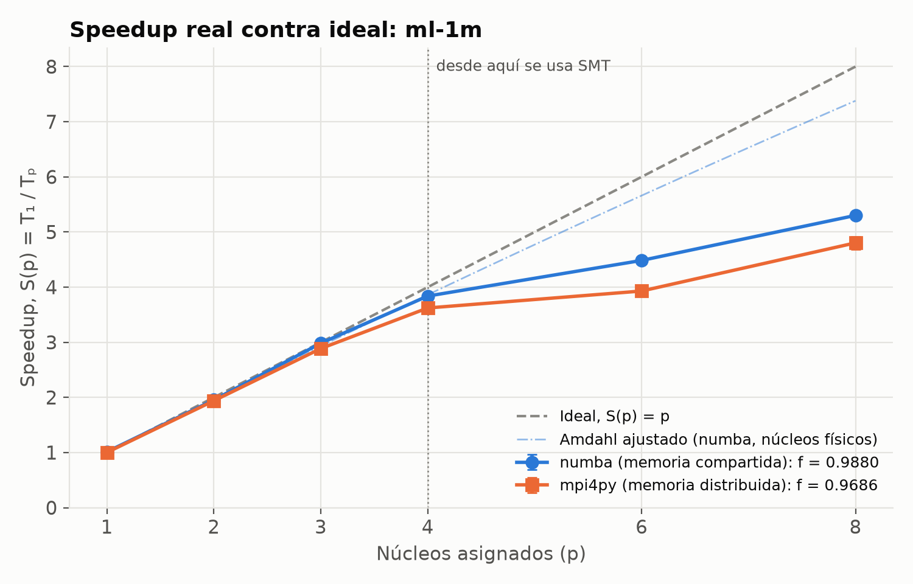
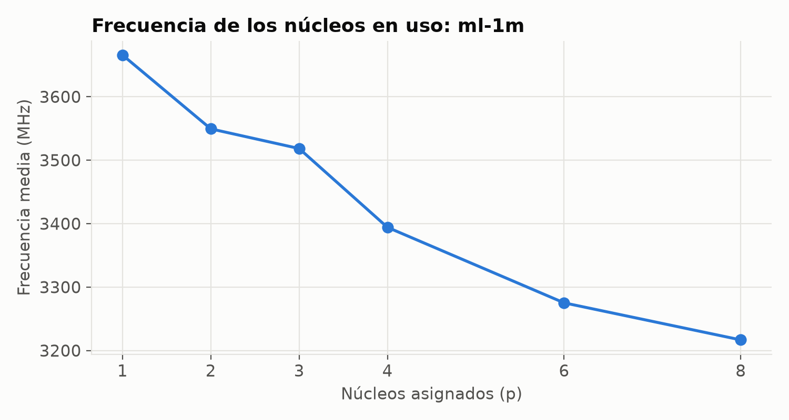
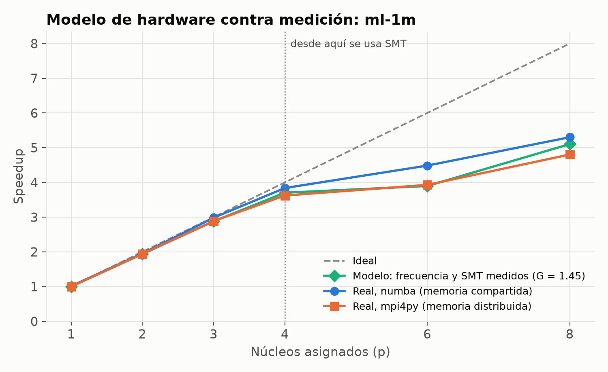
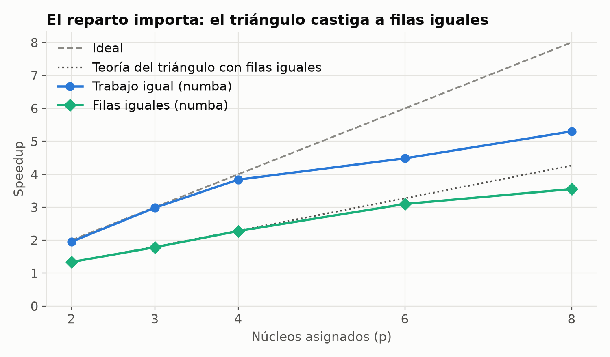
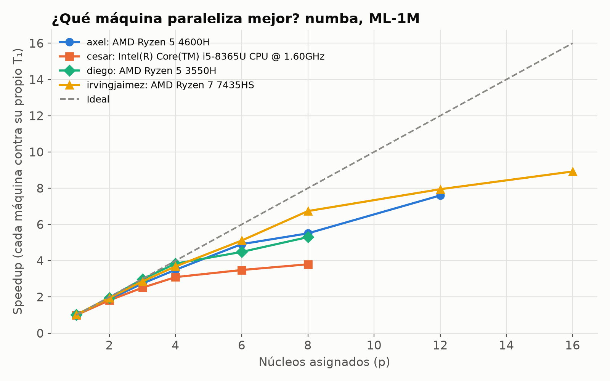

# Análisis de rendimiento e interpretación

Este documento explica **cuánto** mejora el KNN al paralelizarlo y, sobre todo, **por qué no
escala más**. Todas las cifras salen de archivos del repositorio; las hipótesis que no
pudimos comprobar se señalan como tales.

**Equipo de medición principal:** AMD Ryzen 5 3550H, 4 núcleos físicos y 8 lógicos (SMT), L3 de 4 MiB,
22.9 GB de RAM, Linux nativo, laptop conectada a la corriente. Python 3.12, numba 0.68.1,
mpi4py 4.1.2, Open MPI 5.0.11. Especificaciones completas en
[`resultados/diego/especificaciones.json`](../resultados/diego/especificaciones.json).

**Fuentes de datos**

| Archivo | Contenido |
|---|---|
| [`corridas.csv`](../resultados/diego/corridas.csv) | 276 mediciones crudas, 5 de noviembre de 2026 |
| [`RESUMEN.md`](../resultados/diego/RESUMEN.md) | Tablas generadas desde el CSV |
| [`control_mpi.csv`](../resultados/diego/control_mpi.csv) | Control aleatorizado de variantes de MPI, 75 mediciones |
| `ml25m_numba.json`, `ml25m_mpi.json` | MovieLens 25M completo |
| `rangos_p6.jsonl` | Tiempo de cada proceso MPI con p = 6 |
| `verificacion_*.json`, `calidad_ml-1m.json` | Correctitud y calidad de recomendaciones |
| `banda_memoria.csv`, `banda_repeticiones.csv` | Ancho de banda de memoria |

Todos están en `resultados/diego/`. Los resultados de las otras tres máquinas están en
`resultados/<nombre>/` y su comparación en `resultados/comparacion/` (sección 11).

---

## 1. Metodología

**Referencia T₁.** Es la versión secuencial **compilada** con numba, sin hilos. El mismo
código en Python puro es 123 veces más lento: 74.79 s contra 0.608 s con 1,000 usuarios.
Usar Python puro como T₁ mezclaría la ganancia de compilar con la de paralelizar, así que
se reporta aparte.

**Un solo kernel.** Las tres versiones llaman a las mismas funciones de `comun/nucleo.py`.
Entre versiones solo cambia el modelo de paralelismo.

**Controles de medición**

| Control | Por qué |
|---|---|
| Afinidad con `taskset`: primero un hilo por núcleo físico, luego hermanos SMT | Sin esto, OpenMPI colocó dos procesos en el mismo núcleo (sección 4.3) |
| `OMP_NUM_THREADS=1` y equivalentes | Evita paralelismo oculto en NumPy y BLAS |
| Compilación JIT antes de medir | La compilación inflaría los tiempos |
| Orden aleatorio dentro de cada experimento | El calentamiento no favorece a ninguna configuración |
| Espera hasta 70 °C antes de cada medición, máximo 90 s | La CPU llegó a 93.5 °C |
| Registro de frecuencia y temperatura por corrida | Para explicar la curva con datos |
| 5 repeticiones en los experimentos principales; media ± desviación estándar | Se conservan todas las mediciones, incluidos los atípicos |

**Correctitud.** Cada corrida calcula una huella SHA-256 del resultado. Las 276 mediciones
dan una sola huella por configuración de datos. Contra scikit-learn, el error máximo de
similitud es de 1.67×10⁻¹⁴ en ML-1M. De 302,000 vecinos, 80 difieren, y los 80 son empates
de similitud, que scikit-learn no ordena de forma fija.

---

## 2. Resultados de escalabilidad fuerte

### MovieLens 1M: 6,040 usuarios, 18.2 millones de pares

T₁ = 24.92 ± 0.22 s.

| p | numba T (s) | S | E | MPI T (s) | S | E | MHz (numba) |
|---:|---:|---:|---:|---:|---:|---:|---:|
| 1 | 24.59 ± 0.27 | 1.01 | 1.01 | 24.88 ± 0.43 | 1.00 | 1.00 | 3666 |
| 2 | 12.76 ± 0.36 | 1.95 | 0.98 | 12.85 ± 0.61 | 1.94 | 0.97 | 3549 |
| 3 | 8.35 ± 0.03 | 2.98 | 0.99 | 8.63 ± 0.09 | 2.89 | 0.96 | 3518 |
| 4 | 6.49 ± 0.08 | **3.84** | 0.96 | 6.88 ± 0.04 | 3.62 | 0.91 | 3394 |
| 6 | 5.56 ± 0.07 | 4.48 | 0.75 | 6.34 ± 0.05 | 3.93 | 0.65 | 3275 |
| 8 | 4.70 ± 0.03 | **5.30** | 0.66 | 5.19 ± 0.12 | 4.80 | 0.60 | 3217 |



### Goodbooks-10k: muestra de 20,000 usuarios, 200 millones de pares

T₁ = 265.19 ± 0.65 s. Se usó una muestra, en vez de los 53,424 usuarios, para que cupieran
5 repeticiones de cada configuración.

| p | numba S | numba E | MPI S | MPI E |
|---:|---:|---:|---:|---:|
| 2 | 2.01 | 1.01 | 1.99 | 0.99 |
| 4 | **3.94** | 0.99 | 3.78 | 0.95 |
| 8 | **5.84** | 0.73 | 5.43 | 0.68 |

Con un problema más grande, la eficiencia es mayor. No medimos por qué.

---

## 3. La ley de Amdahl no explica la curva

Medimos la parte serial directamente por fases: con p = 1, ordenar el resultado final tarda
0.010 s de 24.9 s. La fracción paralela es **f = 0.9996**, o 0.9989 si se incluye la carga
de datos.

Con ese f, Amdahl permitiría S(4) = 3.99 y S(8) = 7.98. Medimos 3.84 y 5.30 con numba.
**La pérdida no viene de código serial.**

El f ajustado a la curva sí resume lo que vimos, pero no se puede leer como "porción de
código paralelo":

| Ajuste de f | numba | MPI |
|---|---:|---:|
| Solo núcleos físicos, p ≤ 4 | 0.9880 | 0.9686 |
| Todos los p | 0.9348 | 0.9100 |
| Medido por fases | 0.9996 | 0.9996 |

El programa es el mismo; solo cambia qué valores de p entran al ajuste. La métrica de
Karp-Flatt (fracción serial experimental) lo confirma: en numba pasa de 0.014 en p = 4 a
0.068–0.073 en p = 6 y 8. Una fracción serial que **crece** con p indica sobrecarga que
aparece al agregar trabajadores, no una parte serial fija.

Las causas reales son tres, en orden de peso.

---

## 4. Causas medidas

### 4.1 Frecuencia, hasta 4 núcleos

El procesador baja su frecuencia cuando hay más núcleos activos y más calor: de 3666 MHz
con p = 1 a 3394 MHz con p = 4, un 7.4 % menos. Solo eso llevaría a S(4) ≈ 3.70; medimos
3.84. **La frecuencia alcanza para explicar la pérdida hasta 4 núcleos.**

Limitación: la frecuencia es un promedio de muestras cada 0.5 s de `scaling_cur_freq`, así
que es aproximada.



### 4.2 SMT, después de 4

Lo medimos directamente con dos trabajadores en ML-1M:

| Colocación, p = 2 | numba | MPI |
|---|---:|---:|
| Dos núcleos físicos distintos | 12.76 s | 12.85 s |
| Los dos hilos del mismo núcleo | 17.32 s | 17.78 s |

Un núcleo con sus dos hilos rinde **G = 1.45** veces lo que un solo hilo, no el doble.
Los 8 hilos lógicos equivalen a unos 5.8 núcleos completos, antes de contar la frecuencia.

### 4.3 Afinidad: una trampa de OpenMPI

Con `mpirun --use-hwthread-cpus -n 2`, OpenMPI colocó los dos procesos en los dos hilos del
**mismo** núcleo físico: `--report-bindings` muestra `hwt:L0` y `hwt:L1`. Tardó 17.69 s,
igual que el caso SMT de arriba, contra 12.85 s con núcleos distintos.

Sin controlar la afinidad, habríamos atribuido a MPI un costo que en realidad viene del
hardware. Por eso todos los experimentos fijan las CPU con `taskset`.

### 4.4 Reparto estático con capacidades desiguales

Con p = 6 hay 2 núcleos con un solo trabajador y 2 con dos. Todos reciben el mismo
trabajo, pero no van a la misma velocidad. Los tiempos de cada proceso MPI lo muestran
(`rangos_p6.jsonl`):

| Corrida | Procesos rápidos | Procesos lentos |
|---|---|---|
| 1 | 4.78, 4.78 s | 5.71, 5.78, 6.00, 6.02 s |
| 2 | 4.52, 4.81 s | 5.70, 5.88, 5.92, 5.94 s |
| 3 | 5.11, 5.18 s | 6.08, 6.14, 6.23, 6.29 s |

En las tres corridas hay 2 procesos rápidos y 4 lentos: 2 núcleos con un solo proceso y
2 núcleos compartidos. El programa termina cuando termina el más lento.

Un reparto dinámico podría compensarlo, pero **no lo implementamos**.

---

## 5. Modelo de hardware

Con solo la frecuencia y la ganancia SMT, ambas medidas aparte del speedup y sin ajustar
nada:

```
p ≤ núcleos físicos:  S = p · (fₚ / f₁)
p > núcleos físicos:  S = p · (G / 2) · (fₚ / f₁)
```

El término G/2 refleja la sección 4.4: con reparto estático, el programa avanza al ritmo
de los hilos que comparten núcleo.

| p | Modelo | numba | MPI |
|---:|---:|---:|---:|
| 2 | 1.94 | 1.95 | 1.94 |
| 3 | 2.88 | 2.98 | 2.89 |
| 4 | 3.70 | 3.84 | 3.62 |
| 6 | 3.90 | **4.48** | 3.93 |
| 8 | 5.10 | 5.30 | 4.80 |



El modelo reproduce la curva con un error de ±6.2 %, **excepto numba con p = 6**, donde
subestima por 13 %. Nuestra hipótesis es que el sistema operativo mueve los hilos de numba
entre CPUs y reparte el castigo de compartir núcleo. No la pudimos comprobar, porque numba
no expone tiempos por hilo.

---

## 6. Balance de carga en el triángulo

Cada par (u, v) se calcula una sola vez, con u < v. La fila u hace n − u − 1 comparaciones,
así que las primeras filas trabajan mucho más. Con **filas iguales**, el primer bloque se
lleva la fracción 1 − (1 − 1/p)² del trabajo, y la teoría predice
S = 1 / [1 − (1 − 1/p)²].

| p | Teoría | numba, filas iguales | MPI, filas iguales | numba, trabajo igual |
|---:|---:|---:|---:|---:|
| 2 | 1.33 | 1.34 | 1.32 | 1.95 |
| 3 | 1.80 | 1.78 | 1.75 | 2.98 |
| 4 | 2.29 | 2.28 | 2.17 | 3.84 |
| 6 | 3.27 | 3.10 | 2.56 | 4.48 |
| 8 | 4.27 | 3.55 | 2.90 | 5.30 |

Con núcleos físicos, numba coincide con la teoría casi exactamente. Después de p = 4 cae por
debajo, porque la teoría supone núcleos iguales y SMT rompe ese supuesto.

Repartir por **trabajo estimado** (`trabajo_por_fila` y `repartir` en `comun/nucleo.py`)
resuelve el desbalance: con p = 4, filas iguales tarda 10.94 s y trabajo igual 6.49 s.
Es decir, repartir por filas es 69 % más lento.



---

## 7. Por qué MPI es algo más lento que numba

Hicimos un control aleatorizado: 5 variantes intercaladas al azar en la misma sesión, con
5 repeticiones por configuración. La tabla muestra el cambio contra MPI normal; el valor
entre paréntesis es el p-valor de la prueba de Welch.

| Variante | p = 4 | p = 6 | p = 8 |
|---|---:|---:|---:|
| MPI normal | 6.636 s | 5.989 s | 4.872 s |
| numba | −2.7 % | −7.6 % | −4.0 % |
| MPI con datos en memoria compartida (`--datos ventana`) | −1.3 % (0.001) | −0.7 % (0.27) | −1.8 % (0.047) |
| MPI con espera sin girar (`--espera dormir`) | 0.0 % (0.94) | **−4.7 %** (0.0001) | −0.9 % (0.21) |
| Ambas | −1.0 % (0.002) | **−5.4 %** (<0.0001) | −1.9 % (0.04) |

Conclusiones, con cautela por ser pocas repeticiones y varias comparaciones:

1. **Combinar resultados no es la causa.** El árbol de MPI tarda unos 75 ms de ~5 s con p = 8.
2. **Duplicar los datos en cada proceso cuesta poco:** de 0.7 a 1.8 %.
3. **La espera activa importa con p = 6.** Un proceso que terminó sigue ocupando su CPU en
   `Barrier` y le quita capacidad al hilo hermano que sigue trabajando. Es el caso con más
   desbalance (sección 4.4).
4. Con ambas mejoras queda ~2 % de diferencia con numba en p = 6, sin causa identificada.

---

## 8. Memoria y estrategia por bloques (reto extra)

La matriz completa de similitudes crece con n². En MovieLens 25M, con 162,541 usuarios,
pesaría **105.7 GB** en `float32`: 4.6 veces la RAM del equipo.

Nuestra estrategia no la construye:

1. Cada trabajador procesa un bloque de filas del triángulo y guarda solo un **top-k
   parcial** de n × k.
2. Al terminar, los parciales se combinan: en numba fila por fila en paralelo, y en MPI con
   un árbol binomial.
3. La memoria pasa de O(n²) a O(n · k · p).

| ML-25M completo, p = 8 | Tiempo | RAM pico total | Huella |
|---|---:|---:|---|
| numba | 2,471 s (41.2 min) | **1.19 GB** | `2120f7d5e90516ee` |
| MPI | 2,550 s (42.5 min) | 5.15 GB | `2120f7d5e90516ee` |

Fueron 13,209,707,070 pares, con el mismo resultado exacto en ambos modelos. Se corrió una
sola vez por versión y sin T₁ propio, porque una secuencial tomaría horas: sirve para
demostrar viabilidad y memoria, no para medir speedup.

**Por qué MPI usa más memoria:** cada proceso carga su propio intérprete, numba y una copia
de los datos. La cifra suma el pico de cada proceso, así que cuenta varias veces las
bibliotecas compartidas y es una cota superior. En ML-1M, poner los datos en memoria
compartida casi no cambia la RAM (1,962 contra 1,985 MB), porque los datos pesan unos 16 MB
y el intérprete y las bibliotecas, unos 250 MB por proceso.

---

## 9. Otros experimentos

**Escalabilidad débil.** n crece con √p para mantener los pares por trabajador:

| p | n | numba T (s) | Eficiencia débil | MPI T (s) | Eficiencia débil |
|---:|---:|---:|---:|---:|---:|
| 1 | 2000 | 2.47 | 1.00 | 2.52 | 1.00 |
| 4 | 4000 | 2.87 | 0.86 | 2.93 | 0.86 |
| 8 | 5656 | 4.07 | 0.61 | 4.31 | 0.58 |

Se ve la misma caída después de 4 núcleos, por SMT y frecuencia.

**Sobresuscripción.** Con 16 trabajadores en 8 CPU, numba no empeora (4.65 contra 4.70 s) y
MPI empeora 4.4 % (5.42 contra 5.19 s). No investigamos la diferencia.

**Ancho de banda.** El benchmark tipo triad da entre 11.9 y 13.2 GB/s, plano sin importar el
número de hilos. Como el kernel escala casi lineal hasta 4 núcleos con ese ancho de banda
fijo, no parece limitado por memoria. Pero una prueba anterior dio de 16 a 21 GB/s y no
encontramos la causa, así que no lo usamos como argumento principal.

---

## 10. Calidad de las recomendaciones

Evaluación leave-one-out: a cada usuario se le oculta una película bien calificada y se
revisa si aparece entre sus 10 recomendaciones.

| Método | HR@10 | NDCG@10 |
|---|---:|---:|
| KNN, k = 50 | **26.6 %** | 0.155 |
| Recomendar lo más popular | 10.2 % | 0.054 |

KNN acierta 2.6 veces más que la referencia, así que el sistema también sirve como
recomendador.

---

## 11. Comparación entre las cuatro máquinas

Cada integrante clonó el repositorio y corrió `./replicar.sh` en su computadora. Las otras
tres máquinas usaron el perfil rápido: solo ML-1M y 3 repeticiones por punto, contra 5 en la
de Diego, así que sus cifras tienen más ruido. Fuente:
[`resultados/comparacion/COMPARACION.md`](../resultados/comparacion/COMPARACION.md).

**Correctitud:** las cuatro máquinas dan la misma huella, `56043b16668f313e`, en todas sus
corridas de ML-1M, y las cuatro coinciden con scikit-learn (80 vecinos distintos, todos por
empate). El resultado es idéntico en tres procesadores AMD y uno Intel.

| Máquina | Procesador | Núcleos/hilos | Entorno | T₁ (s) | numba S(físicos) | numba S(máx.) | MPI S(máx.) |
|---|---|---|---|---:|---:|---:|---:|
| Irving | Ryzen 7 7435HS | 8/16 | Linux | 18.9 | 6.74 (p = 8) | 8.92 (p = 16) | 5.24 |
| Axel | Ryzen 5 4600H | 6/12 | WSL | 23.9 | 4.91 (p = 6) | 7.60 (p = 12) | 6.34 |
| Diego | Ryzen 5 3550H | 4/8 | Linux | 24.9 | 3.84 (p = 4) | 5.30 (p = 8) | 4.80 |
| César | Core i5-8365U | 4/8 | Linux | 41.6 | 3.09 (p = 4) | 3.80 (p = 8) | 3.38 |



### 11.1 Lo que se repite

- **La fracción paralela medida por fases** es 0.9996 o 0.9997 en las cuatro. En ninguna
  máquina el límite es código serial.
- **SMT no duplica.** En las tres máquinas con Linux nativo, dos hilos del mismo núcleo
  rinden de 1.35 a 1.45 veces uno: G = 1.45 (Diego), 1.43 (Irving) y 1.35 (César). En todas,
  la curva se aplana al pasar de núcleos físicos a hilos.
- **La frecuencia baja al agregar núcleos.** Con numba, de p = 1 a todos los núcleos físicos:
  −7.4 % en la de Diego, −15.5 % en la de César y −21 % en la de Irving.
- **El reparto por filas iguales sigue la teoría** con numba en las cuatro: en p = 2,
  S = 1.31 a 1.34 contra 1.33 teórico.
- **numba es igual o más rápido que MPI** en las cuatro.

### 11.2 Lo que cambia, y lo que no sabemos explicar

**Más núcleos, más speedup, pero no más eficiencia.** La máquina de Irving llega a 8.92 con
16 hilos, pero su eficiencia en núcleos físicos (0.84) es menor que la de Diego (0.96),
porque su frecuencia baja más: de 4,214 a 3,320 MHz.

**César: la más lenta y la que menos escala.** Su T₁ es de 41.6 s y su frecuencia es la más
baja, de 2,660 MHz con un núcleo a 2,248 con cuatro. Es un procesador de bajo consumo para
laptops delgadas. El modelo de hardware predice S(4) = 3.38 y medimos 3.09; la diferencia
no la explica la frecuencia medida. **Hipótesis sin comprobar:** límite de potencia o
temperatura del chip, o ruido por ser solo 3 repeticiones (la desviación estándar en p = 4
es de 0.86 s).

**Irving: MPI escala mucho peor que numba.** Con p = 8, MPI llega a 3.58 y numba a 6.74. El
registro de sensores muestra que con MPI la frecuencia es menor en todos los p: 3,620 contra
4,214 MHz con p = 1, y 2,420 contra 3,320 con p = 8. Por eso MPI ya es más lento con un solo
proceso (21.4 contra 18.5 s). **No sabemos por qué la frecuencia baja más con MPI** en esa
máquina; no se vio en las otras.

**Axel (WSL): no aparece la penalización de SMT.** Dos trabajadores fijados a los hilos
hermanos tardan 12.96 s, igual que en núcleos distintos (12.76 s). **Hipótesis:** en WSL los
CPU que ve Linux son virtuales y Windows decide en qué núcleo real corre cada uno, así que
`taskset` no controla la colocación. WSL tampoco expone la frecuencia, por lo que en esa
máquina no se puede revisar esa explicación.

---

## 12. Conclusiones

1. **El paralelismo funciona:** S(4) = 3.84 y S(8) = 5.30 en ML-1M; 3.94 y 5.84 en Goodbooks.
   En la máquina de Irving, con 8 núcleos, llega a 8.92.
2. **La pérdida no es código serial:** f = 0.9996 medido. Se explica con mediciones
   independientes de hardware: frecuencia hasta 4 núcleos, y después SMT con reparto
   estático.
3. **El reparto importa:** el triángulo con filas iguales es 69 % más lento con p = 4, tal
   como predice la teoría.
4. **numba supera ligeramente a MPI** en una sola máquina, sobre todo por la espera activa
   de MPI cuando hay desbalance. Duplicar datos cuesta poco.
5. **La estrategia por bloques con top-k** hace viable un problema que no cabe en memoria:
   de 105.7 GB a 1.19 GB, con el mismo resultado.
6. **Se reproduce en cuatro máquinas:** misma huella en las cuatro, y en todas la curva se
   aplana al pasar de núcleos físicos a hilos SMT.

**Pendiente sin explicar:** por qué numba supera al modelo con p = 6, la variación del ancho
de banda, el ~2 % restante entre MPI y numba, la baja de frecuencia con MPI en la máquina de
Irving y la eficiencia menor que la del modelo en la de César.

**Trabajo futuro:**
- Reparto dinámico para SMT.
- MPI híbrido con hilos.
- Repetir las mediciones de las otras tres máquinas con 5 repeticiones y Goodbooks.
